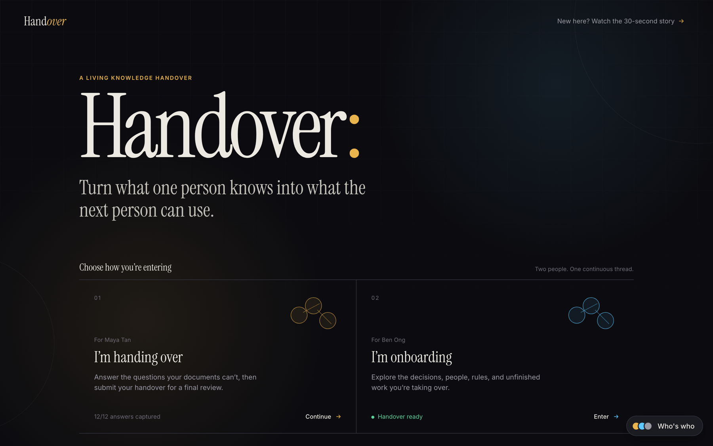
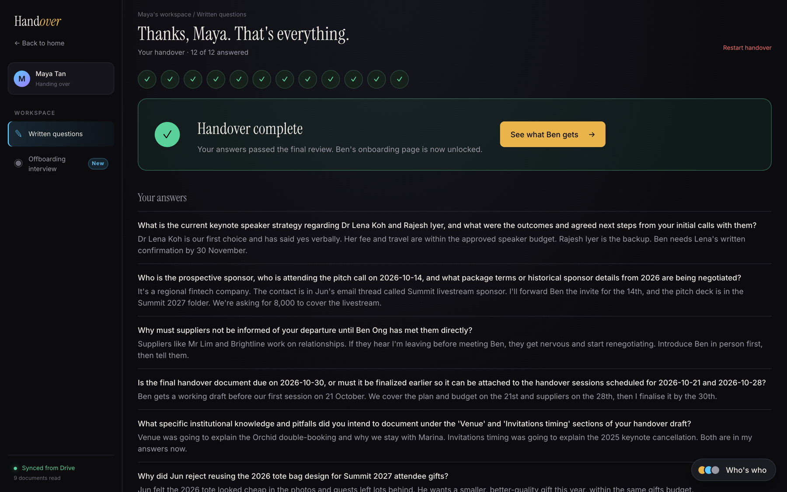
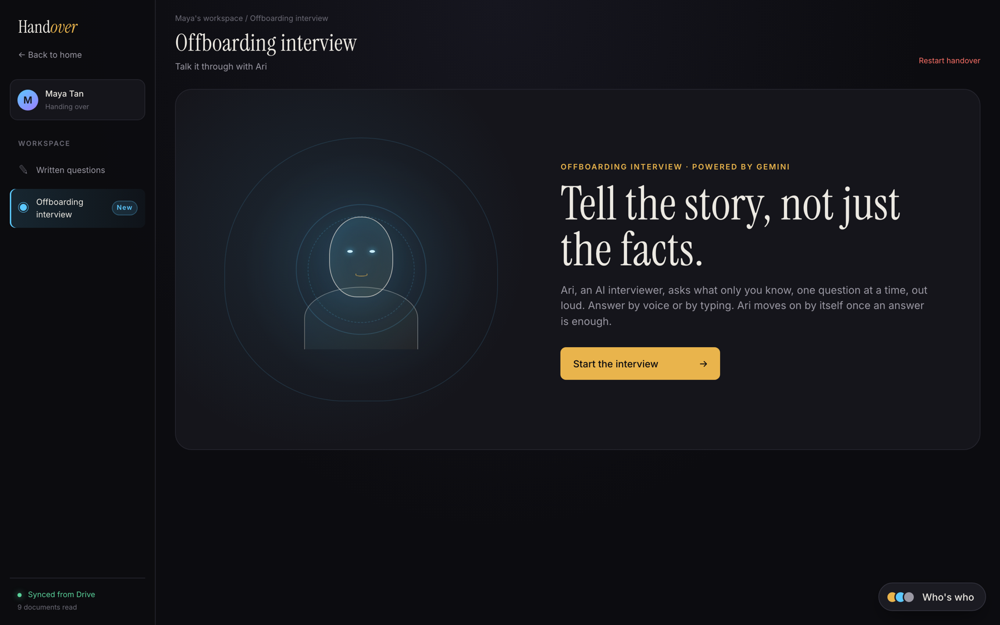
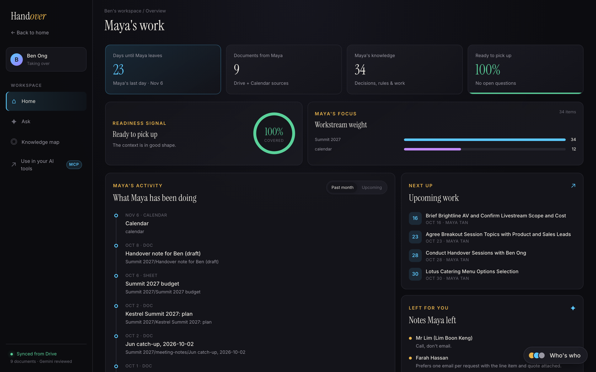
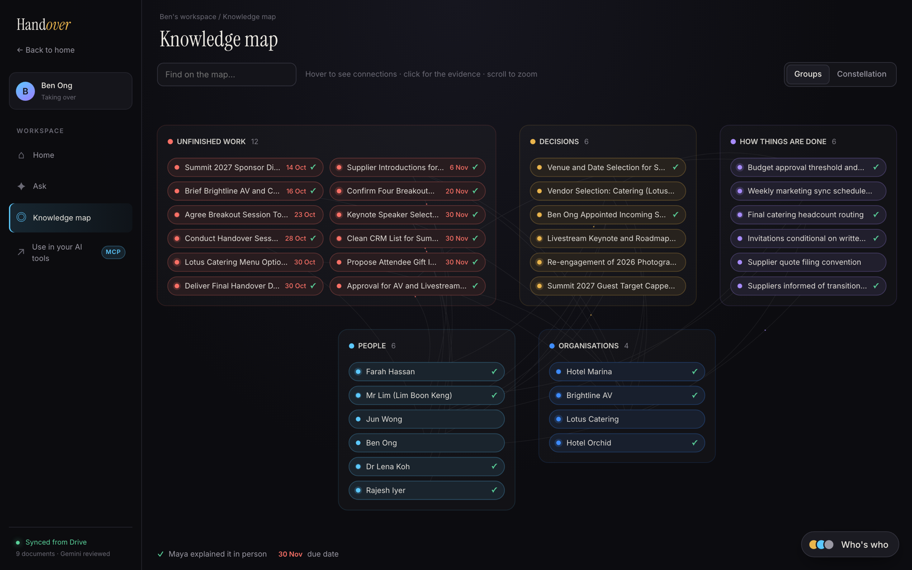
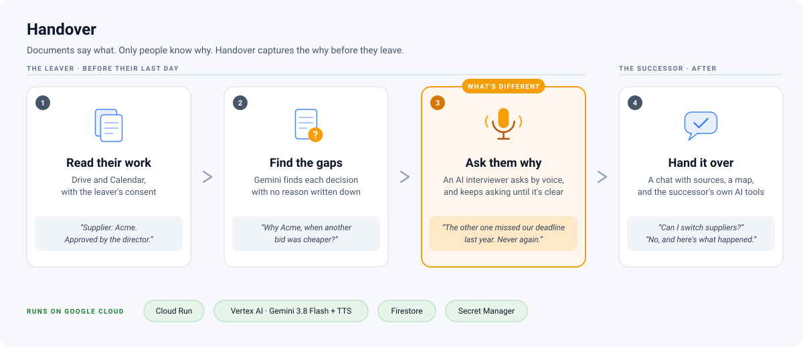

# Handover

**When a teammate leaves, their documents say what they did, almost never why. Handover reads a departing employee's Google Drive and Calendar, finds where the documents go quiet, interviews them for the missing reasons before their last day, and leaves a knowledge base their successor can ask, browse, or plug into any AI tool.**

Entry for the [Google Cloud AI Builder Cup 2026](https://aibuildercup.com), theme **Future of Work & Enterprise Productivity**.

| | |
|---|---|
| **Live app** | https://handover-239830814657.asia-southeast1.run.app |
| **Demo video** | `[PLACEHOLDER: public link, under 3:00]` |
| **Deck (PDF)** | `[PLACEHOLDER: link]` |
| **Team** | `[PLACEHOLDER: team name and members]` |



## The problem

Handover documents are written in the last week by someone who is already leaving. They list tasks, not reasons: why a supplier was chosen, which rule exists because of a past failure, who really decides, what is half-finished. The successor re-learns those lessons the expensive way. One survey put the share of institutional knowledge that is unique to the person in the role, and shared with nobody, at [42%](https://www.hrdive.com/news/inefficient-knowledge-sharing-costs-large-us-businesses-47m-a-year/527892/).

## What it does

1. **Reads the work footprint.** With the leaver's consent (Google OAuth, read-only), Gemini extracts typed knowledge from every Drive document and the calendar: decisions, rules, unfinished work, background, lessons, each with a verbatim quote as evidence.
2. **Finds the gaps.** A second pass merges the extractions into one record per real thing, links them, spots contradictions, and raises a question for every decision or rule whose reason is written nowhere.
3. **Interviews the leaver.** In writing, or in a spoken interview with "Ari", an AI interviewer who narrates the context, asks each question, judges the spoken answer, and asks a sharper follow-up when a successor could not act on it. A final review signs the handover off.
4. **Serves the successor.** A chat that answers only from the handover and cites sources, a knowledge map, and an MCP server so the same knowledge works inside Gemini CLI, Claude or Cursor.

The live app ships with a sample workspace: a fictional events coordinator handing over to a colleague, built from nine synthetic documents and a calendar. Every name in it is invented.

| | |
|---|---|
|  |  |
|  |  |

Screenshots are taken from the live app by `docs/screenshots/take.mjs`.

## How Gemini is used

Every call is tied to something the user sees.

| Step | Gemini does | Technique |
|---|---|---|
| Extract | Typed knowledge and gaps from one document, with quotes | Structured output, one call per document |
| Consolidate | Merge across documents, add typed links, flag contradictions | Structured output |
| Audit gaps | Drop answered gaps, merge duplicates, ask "why?" for every unexplained decision, rank | Structured output |
| Interview | Plan a chronological conversation, speak it, transcribe and judge the spoken answer, write follow-ups | Text-to-speech, audio input, structured output |
| Final review | Check all answers against the knowledge base; at most two rounds of follow-ups | Structured output |
| Answer the successor | Grounded answer from the stored records only, cited ids validated server-side | Streaming, grounding on the store |

Models: `gemini-3.8-flash` and `gemini-3.8-flash-tts`, called through Vertex AI with a service account. The deployed app holds no API key.

## Architecture



| Service | Role |
|---|---|
| **Cloud Run** | UI, API and MCP server in one service, deployed with one command |
| **Vertex AI** | Gemini 3.8 Flash and Flash TTS, authenticated as the service account |
| **Firestore** | Documents, the evidence and merged knowledge layers, gaps, answers, interview and handover state |
| **Secret Manager** | The OAuth client secret |
| **Cloud Build, Drive API, Calendar API** | Container build; the leaver's work footprint |

Two storage layers keep every merged fact traceable to a quote: raw per-document extractions are never edited, and the merged layer everything reads is rebuilt from them. Details: [docs/tech/knowledge-model.md](docs/tech/knowledge-model.md).

## Impact, measured on the sample workspace

| Measure | Value |
|---|---|
| Sources read | 8 Drive files plus 14 calendar events |
| Knowledge records extracted and linked | 34 records, 49 links |
| Questions the documents could not answer, raised for the leaver | 12 |
| Reasons deliberately left out of the sample documents, recovered by the interview | 4 of 4 |
| A cited answer for the successor, end to end on the live service | about 7 s, first words streamed in about 2 s |

**What is different:** existing tools summarise or search documents. Handover starts from what the documents *should* say but do not, and takes those questions to the one person who can answer them before they are gone.

**Beyond the prototype:** more sources (Slack, Gmail, Jira) each need one reader function; the store is already per leaver, so org-wide is a query across them; Vertex AI Vector Search when a knowledge base outgrows one context window; sign-in or IAP in front of the successor view and MCP endpoint, which are open for the demo.

## Run and deploy

```bash
cd app && uv sync --extra dev && cp .env.example .env    # GEMINI_API_KEY, GOOGLE_CLIENT_ID, GOOGLE_CLIENT_SECRET
uv run uvicorn handover.api:app --port 8080 --reload     # API
cd ../ui && npm install && npm run dev                    # UI at http://localhost:5173
cd ../app && uv run pytest                                # tests
./deploy.sh                                               # from the repo root: Cloud Build, then Cloud Run
```

Every API route, CLI command and the one-time Cloud project setup: [app/README.md](app/README.md). Front end: [ui/README.md](ui/README.md). MCP from Claude Code: `claude mcp add --transport http handover <live url>/mcp`.

No secrets are committed: the OAuth secret lives in Secret Manager, local keys in a gitignored `.env`. All demo data is synthetic and every person and company in it is fictional.

## Team and licence

`[PLACEHOLDER: names and roles]` · `[PLACEHOLDER: licence, and add a LICENSE file]`
